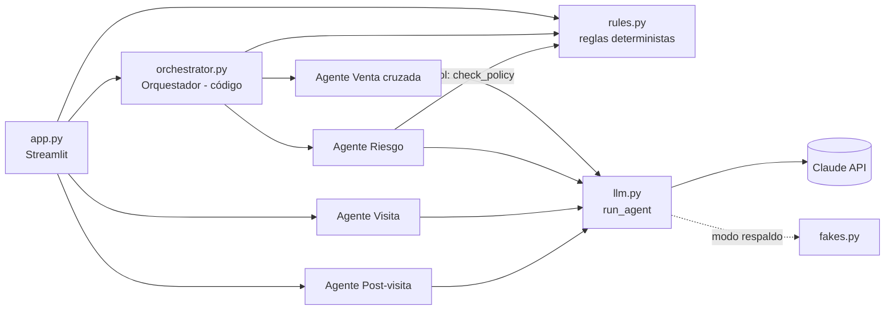
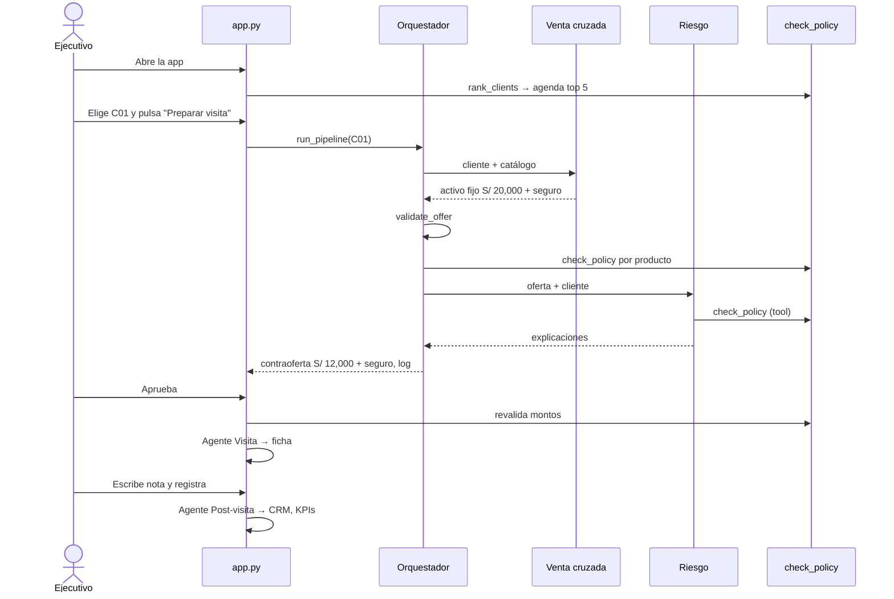

# Crosspilot: export de la conversación para Claude Design

Fecha del export: 17 de octubre de 2026.
Autor: Carlos Dávila y su equipo, hackathon **Hack AI Agents Impact** (NTT DATA × Sundai LATAM, Perú Tech Week 2026), sector **Banca**.

**Cómo usar este archivo en Claude Design:** súbelo como contexto y pide, por ejemplo: "Con este brief, diseña las pantallas de Crosspilot, empezando por la sección 3 (la pantalla principal)". Itera una pantalla o un componente a la vez.

**Restricción técnica importante:** la app real se construye en **Streamlit** (Python, un día de desarrollo). Los diseños deben poder implementarse con componentes de Streamlit (`st.chat_message`, `st.metric`, `st.dataframe`, `st.columns`, `st.expander`, botones, `st.number_input`, `st.toggle`) más CSS ligero. Si una idea de diseño excede eso, marcarla como "ideal" y proponer una versión viable en Streamlit.

---

## Parte 1. Brief de diseño

### 1.1 Qué es Crosspilot

Un copiloto multiagente de **venta cruzada** para el **ejecutivo de negocios** de un banco de microfinanzas en Perú. Prioriza clientes, propone el siguiente producto, lo valida contra la política de riesgo, prepara la visita y registra el resultado. **El ejecutivo aprueba todo.**

- **Problema que resuelve:** muchos clientes tienen un solo producto, y cada uno es ingreso que se queda en la mesa. El ejecutivo no sabe qué ofrecer ni cuándo, no tiene tiempo de preparar la oferta, y muchas ofertas terminan rechazadas por riesgo o sobreendeudan al cliente.
- **Métrica central:** productos por cliente (de 2.2 a 2.4 en el demo).
- **Frase para el jurado:** "No reemplazamos al ejecutivo: le damos un equipo para vender más, y mejor."

### 1.2 Usuarios

- **Ejecutivo de negocios (usuario único):** visita microempresarios (taller de confección, bodega, ferretería). Trabaja con prisa, a veces desde el celular o una laptop en la agencia. Necesita entender en segundos qué ofrecer y por qué.
- **Jurado (espectador):** ve el demo proyectado en una pantalla grande durante 3 minutos. Debe entender la negociación entre agentes sin explicación.

### 1.3 Principios de diseño

1. **El humano decide.** Cada oferta pasa por un paso de aprobación claro y visible. Nada se envía solo.
2. **La negociación entre agentes es el momento estrella.** Venta cruzada propone, Riesgo contraoferta, el Orquestador cierra. Debe leerse como una conversación entre tres personajes, con remitente y color propios.
3. **Un vistazo basta.** Pantalla única, de arriba abajo, con una sola acción principal por sección.
4. **Legible en proyector.** Texto grande, contraste alto, sin detalles finos.
5. **Venta sana.** La interfaz refuerza que el riesgo importa: los vetos y contraofertas se muestran con claridad, no se esconden.
6. **Español, frases cortas.**

### 1.4 Identidad visual (la del deck del proyecto)

| Rol | Color | Uso |
|---|---|---|
| Fondo oscuro | `#0F2A2E` | Barra lateral, portada |
| Teal profundo | `#0B4F57` | Orquestador, énfasis, tarjetas oscuras |
| Teal principal | `#007F73` | Venta cruzada, acciones primarias, iconos |
| Menta claro | `#8FD3C4` | Acentos sobre fondo oscuro |
| Fondo claro de tarjetas | `#EAF4F2` | Tarjetas, filas alternas |
| Ámbar | `#F2B134` | Aprobación humana, advertencias suaves |
| Naranja quemado | `#C2410C` | Riesgo (contraoferta y veto) |
| Gris azulado | `#4A6572` | Texto secundario |
| Blanco | `#FFFFFF` | Fondo de página |

- **Tipografía:** títulos en Cambria (serif), texto en Calibri. Alternativas aceptables si Streamlit no las carga: Georgia y Segoe UI.
- **Iconos:** estilo sólido simple (Font Awesome). Circulares sobre fondo de color.
- **Tarjetas:** esquinas redondeadas (~10 px), sin sombras fuertes, fondo `#EAF4F2`.
- **Personajes de los agentes** (color + icono + emoji de respaldo para Streamlit):

| Agente | Color | Icono | Avatar Streamlit |
|---|---|---|---|
| VENTA CRUZADA | `#007F73` | diana | 🎯 |
| RIESGO | `#C2410C` | escudo | 🛡️ |
| ORQUESTADOR | `#0B4F57` | diagrama de nodos | 🧭 |
| Ejecutivo (humano) | `#F2B134` | persona con corbata | 👤 |

### 1.5 Pantalla principal (una sola página, de arriba abajo)

**Barra lateral (fondo `#0F2A2E`)**
- Título "Crosspilot", subtítulo "Copiloto de venta cruzada".
- Interruptor "Modo respaldo" (plan B sin API).
- 4 métricas, siempre visibles: **Productos por cliente** (con delta frente a 2.2), **Ofertas aprobadas**, **Productos aceptados**, **Vetos de riesgo**.
- Botón "Reiniciar demo".

**Sección 1. Agenda del día**
- Tabla con los 5 clientes de mayor potencial: cliente, negocio, productos actuales, productos elegibles y puntaje.
- Selector con toda la cartera (por defecto, el primero de la agenda).
- Botón principal "Preparar visita". Mientras trabaja: "Los agentes están trabajando…".

**Sección 2. Negociación entre agentes**
- Chat con un mensaje por entrada, remitente visible y color por agente.
- Ejemplo del demo (cliente C01, Rosa Huamán, taller de confección en La Victoria):
  - ORQUESTADOR: "Preparo la visita a Rosa Huamán: buscamos el siguiente producto."
  - VENTA CRUZADA: "Financiar la remalladora y proteger el taller." Crédito activo fijo por S/ 20,000 (razón: cotizó una remalladora industrial de S/ 20,000) y seguro de negocio (razón: su maquinaria no tiene seguro).
  - RIESGO: crédito activo fijo, **CONTRAOFERTA** por S/ 12,000 (excede el límite de endeudamiento); seguro de negocio, **APROBADO**.
  - ORQUESTADOR: "Acepto la contraoferta de Riesgo: crédito activo fijo por S/ 12,000. Pasa a aprobación del ejecutivo."
- Decisiones de riesgo posibles: **APROBADO**, **CONTRAOFERTA**, **VETO**. Cada una merece una etiqueta visual distinta (por ejemplo, verde teal, naranja, rojo oscuro).

**Sección 3. Aprobación del ejecutivo** (solo cuando hay oferta pendiente)
- Cada producto con casilla "Incluir" y, si es crédito, un campo de monto editable con paso de S/ 500.
- Botones "Aprobar" y "Rechazar".
- Si el ejecutivo sube el monto por encima del máximo permitido (ejemplo: S/ 15,000 cuando el máximo es S/ 12,000), aparece un error que bloquea la aprobación y explica el motivo.

**Sección 4. Ficha de visita** (tras aprobar)
- Resumen del cliente (2 líneas), oferta aprobada, 3 puntos de conversación, 2 objeciones probables con su respuesta, siguiente paso. Se lee en un minuto.

**Sección 5. Post-visita**
- Campo de texto "Nota de la visita" y botón "Registrar".
- Tabla con el CRM de la sesión: resultado, productos aceptados, siguiente acción, fecha de seguimiento, resumen.

**Estados a diseñar:** inicio (sin visita), agentes trabajando, negociación completa, oferta pendiente de aprobación, error de aprobación (monto excedido), "Sin oferta viable", visita aprobada con ficha, visita registrada con KPI actualizado, error de agente ("El agente X no respondió. Activa el Modo respaldo y vuelve a intentar."), modo respaldo activo.

### 1.6 Cartera de demo (datos sintéticos)

10 clientes inventados, 22 productos en total (2.2 por cliente). Los 5 primeros de la agenda: C01 Rosa Huamán (taller de confección), C02 Jorge Mamani (bodega), C05 Ana Flores (salón de belleza), C07 Carmen Díaz (abarrotes al por mayor), C04 Pedro Salazar (ferretería). Catálogo: crédito capital de trabajo, crédito activo fijo, seguro de negocio, cuenta de ahorro, cobro con QR.

### 1.7 Guion del demo (3 minutos)

| Tiempo | Qué se muestra |
|---|---|
| 0:00 a 0:30 | Problema: clientes con un solo producto. KPI de la barra lateral: 2.2 productos por cliente. |
| 0:30 a 0:50 | Agenda del día: C01 primero por potencial de venta cruzada. |
| 0:50 a 1:40 | "Preparar visita": Venta cruzada propone S/ 20,000 + seguro, Riesgo contraoferta S/ 12,000, Orquestador cierra. |
| 1:40 a 2:10 | El ejecutivo intenta subir a S/ 15,000: bloqueado. Deja 12,000 y aprueba. Sale la ficha. |
| 2:10 a 2:35 | Nota de visita: "Aceptó ambos". CRM actualizado, KPI sube a 2.4. |
| 2:35 a 3:00 | Business case: fórmula de utilidad incremental. Frase final. |

### 1.8 Lo que Claude Design puede explorar

- Cómo hacer que la negociación entre agentes se lea de un vistazo (burbujas, líneas de tiempo, etiquetas de decisión).
- Jerarquía de la pantalla única para proyector y para laptop.
- Versión para celular del ejecutivo en campo.
- Cómo mostrar el KPI "productos por cliente" de forma memorable.
- Estados de error y de espera.

---

## Parte 2. Registro de la conversación

Los mensajes del usuario van textuales. Las respuestas del asistente van completas donde definen producto o diseño, y resumidas donde son operativas. Las instrucciones `/caveman` y `/ponytail` del usuario fijaron el estilo de las respuestas (muy breve, sin relleno, mínimo código); no afectan el diseño del producto.

### Turno 1. Usuario

> Analiza esta hackaton y dime 5 ideas para desarrollar en banca: https://luma.com/pid3ayb4

### Turno 1. Asistente

**Resumen del hackathon (Hack AI Agents Impact, NTT DATA × Sundai LATAM, Perú Tech Week):**
- Es de un solo día, en equipos de 4, con tres sectores: Banca, Minería y Manufactura. El sector se asigna a las 10:25.
- Se construye entre las 10:45 y las 17:00 en tres sprints: flujo base, "make it agentic" (tools, reglas, coordinación, human-in-the-loop) e integración y demo.
- El entregable es problema, solución, **demo funcional en vivo**, impacto y código. No basta con una idea.
- Habrá una charla de Project NANDA (MIT) sobre agentes que interactúan entre sí, con su sandbox NANDA Town.
- El registro requiere aprobación de los organizadores.

Con solo unas 6 horas de desarrollo, conviene elegir ideas con un flujo acotado, datos sintéticos y un punto claro de aprobación humana.

**5 ideas para Banca:**

1. **Agente de pre-evaluación crediticia para microempresarios.** Recibe fotos de cuadernos de ventas, boletas o movimientos de Yape. Un agente extrae los datos, otro estima capacidad de pago y otro arma el expediente. El analista solo aprueba o rechaza. Impacto: pasar de días a minutos en créditos pequeños.
2. **Agente anti-fraude con investigación automática.** Ante una alerta de transacción sospechosa, un agente reúne el historial del cliente, otro revisa patrones y dispositivos, y otro redacta el caso con una recomendación (bloquear, contactar o liberar). Un humano confirma. Impacto: menos falsos positivos y menor tiempo por caso.
3. **Agente de cobranza empática y personalizada.** Analiza el perfil del cliente moroso, propone una estrategia (reprogramación, recordatorio o llamada) y redacta el mensaje por WhatsApp. Otro agente simula la negociación y registra los compromisos de pago. Impacto: mejor recuperación y mejor trato al cliente.
4. **Agente de onboarding y KYC.** Valida el DNI, extrae los datos, cruza listas de control, detecta inconsistencias y deja al cliente listo para abrir cuenta en un chat. Si hay dudas, escala a un oficial de cumplimiento. Impacto: menos abandono en la apertura de cuentas.
5. **Asistente de agentes para el ejecutivo de negocios (usando NANDA Town).** Una red de agentes que colaboran entre sí: uno de agenda y cartera, otro de oportunidades de venta cruzada y otro de preparación de visita. Después de la visita, un agente registra la información en el CRM. Impacto: más productividad comercial.

**Recomendación:** las ideas 1 y 2 son las más fáciles de demostrar en vivo. La 5 puede destacar más por originalidad, pero es la más riesgosa de terminar en un día.

### Turno 2. Usuario

> Desarrolla más la 5

### Turno 2. Asistente

**Idea 5: copiloto multiagente para el ejecutivo de negocios.**

Escenario: son las 8:00 y un ejecutivo de banca pyme tiene 5 visitas hoy. Un equipo de agentes le arma el día, le prepara cada visita y registra los resultados después.

Agentes:
1. **Orquestador:** lee agenda y cartera, prioriza a qué clientes visitar y reparte el trabajo.
2. **Oportunidades:** analiza los movimientos del cliente (datos sintéticos) y detecta qué producto le calza.
3. **Riesgo y cumplimiento:** valida cada oferta contra reglas de política. Puede vetar o contraofertar.
4. **Preparación de visita:** genera una ficha de una página con puntos de conversación, objeciones y la oferta aprobada.
5. **Post-visita:** convierte una nota en registro de CRM, próximos pasos y cita de seguimiento.

Lo que lo hace "agentic": los agentes se coordinan entre sí (Oportunidades propone S/ 20,000, Riesgo responde que excede el límite y contraoferta S/ 12,000, el Orquestador decide). Human-in-the-loop: el ejecutivo aprueba o edita antes de que se envíe la oferta. Extensión opcional con NANDA Town: el cliente tiene su propio agente que negocia con el del banco; los detalles técnicos del sandbox se confirman en la charla de las 9:55.

Plan por sprints (equipo de 4): Sprint 1 (10:45 a 13:00) datos sintéticos y flujo Oportunidades a Ficha; Sprint 2 (14:00 a 15:30) Riesgo, negociación, Orquestador y aprobación humana; Sprint 3 (15:50 a 17:00) Post-visita, interfaz, URL, repositorio y pitch. Si el tiempo aprieta, Post-visita se recorta primero. Reparto sugerido: datos y reglas, agentes y herramientas, interfaz y despliegue, pitch e impacto.

Stack simple: API de Claude con tool use, SQLite o JSON, Streamlit o web ligera.

### Turno 3. Usuario

> ayudame a armar el business case de esta propuesta en una ppt para que todo el equipo tenga claro lo que se hará /caveman

### Turno 3. Asistente

Se creó un deck de 12 láminas (**Business_Case_Copiloto_Multiagente.pptx**): portada, plan en una página, problema, solución (Orquestador + 4 agentes + humano), negociación entre agentes, demo en 3 minutos, impacto esperado, stack, sprints, roles, riesgos y próximos pasos. Los números de impacto del gráfico (30 min a 5 min por visita) eran supuestos ilustrativos.

### Turno 4. Usuario

> ok, pero quiero que hagas un énfasis en la venta cruzada porque ese es el principal problema que resuelve y mejora las utilidades de quien contrate esta solución /caveman

### Turno 4. Asistente

Se rehízo el deck con venta cruzada como eje (**Business_Case_Copiloto_Venta_Cruzada.pptx**, 13 láminas):

1. Portada: "Copiloto de venta cruzada para el ejecutivo de negocios".
2. El plan en una página: cada cliente con un solo producto es ingreso en la mesa. Tres cifras: 5 agentes, 1 objetivo (más productos por cliente), 100% de ofertas con aprobación humana.
3. La venta cruzada se queda en la mesa: clientes con un solo producto (dolor principal), sin tiempo para preparar la oferta, ofertas que no pasan riesgo.
4. Por qué la venta cruzada mueve utilidades: más productos por cliente, más ingreso por cliente, mayor retención, menor costo comercial. Resultado: más utilidad por ejecutivo con la misma cartera.
5. La solución: Orquestador, agente Venta cruzada (destacado), Riesgo, Visita, Post-visita y aprobación humana.
6. Agentes que negocian entre sí (ejemplo de contraoferta de S/ 20,000 a S/ 12,000).
7. Demo en 3 minutos (5 pasos).
8. Business case ilustrativo: utilidad incremental anual = ejecutivos × clientes por ejecutivo × productos adicionales por cliente × margen anual por producto. Supuestos: 100 ejecutivos, 300 clientes por ejecutivo, S/ 300 de margen por producto adicional. Escenarios: S/ 450k, 900k y 1.35M al año (+0.05, +0.10 y +0.15 productos por cliente). Todo ilustrativo, a reemplazar con datos del banco.
9. Stack y arquitectura.
10. Plan por sprints.
11. Roles del equipo.
12. Riesgos y mitigación (incluye "venta cruzada agresiva").
13. Próximos pasos y frase para el jurado.

Identidad visual del deck: la paleta y las tipografías de la sección 1.4. Nota: la lámina 6 del deck habla de "ampliación"; en el spec se cambió a crédito activo fijo, y el deck menciona "nota de voz" mientras el spec usa nota escrita.

### Turno 5. Usuario

> ahora, arma el Spec Driven Development de este proyecto que se llamará "Crosspilot" para desarrollarlo con claude code, hazlo detallado /ponytail

### Turno 5. Asistente

Se creó el spec en `crosspilot/`: `CLAUDE.md`, `specs/requirements.md`, `specs/design.md` y `specs/tasks.md` (el contenido completo está en la Parte 3 de este archivo).

Decisiones de diseño técnico:
- Python + Streamlit + SDK de Anthropic. Sin frameworks de agentes, sin base de datos, sin backend aparte.
- **El código decide, el LLM redacta.** Riesgo, montos, agenda y flujo son deterministas, así el demo en vivo no depende del modelo.
- El Orquestador es código, no un LLM. Hay 4 agentes LLM (Venta cruzada, Riesgo, Visita, Post-visita) con un solo bucle de tool use.
- Modo respaldo: sirve para tests sin red y como plan B si cae el wifi.
- Un dueño por archivo, para que 4 personas usen Claude Code en paralelo sin conflictos.

Pendientes y riesgos señalados: ajustar el texto del deck (ampliación a crédito activo fijo), nota de visita escrita en vez de voz (la API de Claude no transcribe audio), verificar el ID del modelo y cómo Streamlit Cloud expone los Secrets, y confirmar con los organizadores si se permite traer código o datos preparados.

### Turno 6. Usuario

> que opinas de usar supabase para el backend?

### Turno 6. Asistente

Para el hackathon, no. Para después, sí.
- **Por qué no ahora:** los 10 clientes caben en memoria; suma una pieza que puede fallar en vivo (red, keys, RLS, tiempos); rompe el aislamiento por sesión (con una base compartida, dos jurados se pisan los datos y "Reiniciar demo" pasa a ser un borrado real); consume tiempo del sprint 2.
- **Cuándo sí:** piloto real con varios ejecutivos e historial entre días, auditoría de quién aprobó qué, autenticación por ejecutivo. Las reglas de `rules.py` no cambian; solo se reemplaza `data.new_state()`.
- **Si se quiere persistencia en el demo:** una sola tabla `crm` como extra, fuera de la ruta crítica. SQLite no sirve en Streamlit Community Cloud porque el disco se borra al reiniciar.
- **Banco real:** datos reales de clientes en una nube externa probablemente choquen con las políticas de seguridad del banco; habría que pasar por TI y Riesgos. No se verificaron precios ni límites actuales de Supabase.

### Turno 7. Usuario

> voy a hacer el diseño con Claude Design, exporta todo el chat para subirlo en Claude Design e ir iiterando la solución

### Turno 7. Asistente

Este archivo.

---

## Parte 3. Spec completo (anexo)

A continuación, los cuatro archivos del spec tal cual se entregaron. Para el diseño, lo más relevante es `design.md` §10 (Interfaz) y `requirements.md` (R1 a R10).


---

<!-- Archivo: crosspilot/CLAUDE.md -->

# Crosspilot

Copiloto multiagente de **venta cruzada** para el ejecutivo de negocios de un banco de microfinanzas.
Prioriza clientes, propone el siguiente producto, lo valida contra la política de riesgo, prepara la
visita y registra el resultado. El ejecutivo aprueba todo.

Proyecto de hackathon (un día, demo en vivo). Entregable: URL pública + repositorio + demo + pitch.

## Fuente de verdad

Lee siempre, en este orden, antes de escribir código:

1. `specs/requirements.md`: qué debe hacer (requisitos R1–R10 con criterios de aceptación).
2. `specs/design.md`: cómo está construido (datos, reglas, agentes, UI).
3. `specs/tasks.md`: qué tarea toca y cuándo está terminada.

Si el código y el spec no coinciden, el spec manda. Si el spec no cubre algo, pregunta antes de inventar.

## Stack

- Python 3.11+
- `streamlit` (UI y despliegue), `anthropic` (SDK), `pytest` (solo tests)
- Nada más. No agregar dependencias sin preguntar.

## Comandos

```bash
pip install -r requirements.txt
streamlit run app.py                          # app con Claude real (requiere ANTHROPIC_API_KEY)
CROSSPILOT_FAKE_LLM=1 streamlit run app.py    # app sin API (respuestas de respaldo)
pytest -q                                     # tests, nunca llaman a la API
```

## Cómo trabajar

1. Implementa **una tarea de `specs/tasks.md` a la vez**, en orden.
2. Al terminar: corre `pytest -q`, marca la tarea con `[x]` y haz commit `T<id>: <resumen>`.
3. Si una tarea no se puede cumplir tal como está escrita, detente y explica por qué.

## Reglas del proyecto

- **El LLM redacta, el código decide.** Montos, aprobaciones de riesgo, orden de la agenda y flujo
  entre agentes son código determinista (`rules.py`, `orchestrator.py`). El texto del LLM nunca puede
  cambiar una decisión de `check_policy`.
- **Sin frameworks de agentes** (LangChain, CrewAI, AutoGen, etc.). Un solo bucle de tool use en `llm.py`.
- **Estado por sesión:** todo lo mutable vive en `st.session_state["state"]` y se pasa como argumento.
  Nada de variables globales mutables: varios jurados pueden abrir la URL a la vez.
- **Valida en el borde:** lo que escribe el ejecutivo y lo que devuelve el LLM se valida en código
  antes de usarse.
- **Datos solo sintéticos** (`data/seed.json`). Nunca datos reales de clientes.
- **Secretos:** `ANTHROPIC_API_KEY` solo por variable de entorno o Secrets de Streamlit. Nunca en el repo.
- Interfaz y prompts en **español**; identificadores de código en **inglés**.
- Funciones cortas, sin clases salvo que el spec las pida. Sin capas "para después".
- Un atajo con límite conocido lleva comentario: `# shortcut: <límite>, <cuándo mejorarlo>`.

## No hacer

Autenticación, base de datos, Docker, async, colas, caché, multiidioma, transcripción de audio,
integración con NANDA Town (es un extra fuera del spec base).


---

<!-- Archivo: crosspilot/specs/requirements.md -->

# Crosspilot: requisitos

## 1. Contexto

Muchos clientes de un banco de microfinanzas tienen un solo producto. Cada uno es ingreso que se queda
en la mesa: el ejecutivo no sabe qué ofrecer ni cuándo, no tiene tiempo para preparar la oferta, y
muchas ofertas terminan rechazadas por riesgo o sobreendeudan al cliente.

Crosspilot es un equipo de agentes que ayuda al ejecutivo a **vender más productos a sus clientes
actuales, sin perder el control del riesgo**. La métrica que importa es **productos por cliente**.

Restricciones: se construye en un día, con 4 personas, y se demuestra en vivo en 3 minutos.

## 2. Usuarios

- **Ejecutivo de negocios:** usuario único de la app. Prepara visitas, aprueba ofertas, registra resultados.
- **Jurado:** mira el demo y puede abrir la URL. No es usuario del flujo.

## 3. Glosario

| Término | Significado |
|---|---|
| Venta cruzada | Ofrecer a un cliente actual un producto que todavía no tiene. |
| Capacidad disponible | Deuda adicional que el cliente puede asumir según la política. |
| Contraoferta | Oferta de crédito ajustada al monto máximo que permite la política. |
| Veto | Producto que Riesgo rechaza sin contraoferta posible. |
| Ficha de visita | Resumen de una página que el ejecutivo lee antes de visitar al cliente. |
| CRM simulado | Lista en memoria de los resultados de visita de la sesión. |

## 4. Requisitos funcionales

Formato EARS. Cada criterio tiene un ID que usan las tareas y los tests.

### R1. Agenda priorizada

- **R1.1** CUANDO el ejecutivo abre la app, EL SISTEMA DEBE mostrar los 5 clientes con mayor potencial
  de venta cruzada, ordenados de mayor a menor.
- **R1.2** El potencial DEBE calcularse en código con `rank_clients` (ver diseño §6.2), nunca con el LLM.
- **R1.3** Cada fila DEBE mostrar nombre, negocio, productos actuales, productos elegibles y puntaje.
- **R1.4** EL SISTEMA DEBE permitir elegir cualquier cliente de la cartera, no solo los 5 de la agenda.

### R2. Propuesta de venta cruzada

- **R2.1** CUANDO el ejecutivo elige un cliente y pulsa "Preparar visita", el agente Venta cruzada DEBE
  proponer 1 o 2 productos del catálogo que el cliente no tenga.
- **R2.2** Cada producto propuesto DEBE incluir una razón basada en las señales del cliente.
- **R2.3** Los productos de crédito DEBEN incluir monto en soles; los demás, sin monto.
- **R2.4** EL SISTEMA DEBE descartar en código, y registrar en la conversación el motivo, todo producto
  inexistente, ya contratado, de crédito sin monto válido, o cualquier crédito después del primero.
- **R2.5** SI no queda ningún producto válido, EL SISTEMA DEBE mostrar "Sin oferta viable" y no seguir.

### R3. Revisión de riesgo

- **R3.1** Cada producto propuesto DEBE evaluarse con `check_policy` (diseño §6.1).
- **R3.2** SI un crédito excede la capacidad disponible y el máximo permitido alcanza el monto mínimo del
  producto, EL SISTEMA DEBE contraofertar con el máximo permitido.
- **R3.3** SI el cliente tiene más de 15 días de atraso máximo en 12 meses, o el máximo permitido es
  menor que el monto mínimo del producto, EL SISTEMA DEBE vetar el crédito.
- **R3.4** Los productos que no son crédito DEBEN aprobarse si el cliente no los tiene.
- **R3.5** La decisión (aprobado, contraoferta, veto) y el monto DEBEN venir de `check_policy`. El agente
  Riesgo solo redacta la explicación; si su texto contradice la regla, gana la regla.

### R4. Negociación visible

- **R4.1** EL SISTEMA DEBE mostrar el intercambio entre agentes como mensajes en orden, con remitente
  visible: VENTA CRUZADA, RIESGO, ORQUESTADOR.
- **R4.2** El Orquestador DEBE cerrar la negociación con un mensaje que diga qué se acepta, qué cambia y
  qué se descarta.

### R5. Aprobación humana

- **R5.1** Ninguna oferta DEBE pasar a "aprobada" sin que el ejecutivo pulse "Aprobar".
- **R5.2** El ejecutivo DEBE poder quitar productos y editar montos de crédito antes de aprobar.
- **R5.3** CUANDO el ejecutivo edita un monto, EL SISTEMA DEBE revalidarlo con `check_policy` al aprobar;
  SI no pasa, DEBE bloquear la aprobación y mostrar el motivo.
- **R5.4** El ejecutivo DEBE poder rechazar la oferta; en ese caso no se genera ficha.

### R6. Ficha de visita

- **R6.1** CUANDO la oferta se aprueba, el agente Visita DEBE generar una ficha con: resumen del cliente,
  oferta final, 3 puntos de conversación, 2 objeciones probables con respuesta y siguiente paso.
- **R6.2** La ficha NO DEBE cambiar productos ni montos aprobados.

### R7. Registro post-visita

- **R7.1** CUANDO el ejecutivo escribe la nota de la visita y pulsa "Registrar", el agente Post-visita
  DEBE convertirla en un registro de CRM: resultado, productos aceptados, siguiente acción, fecha de
  seguimiento y resumen.
- **R7.2** Los productos aceptados DEBEN ser un subconjunto de la oferta aprobada; la fecha DEBE tener
  formato `AAAA-MM-DD` y no ser anterior a hoy. SI no cumple, EL SISTEMA DEBE mostrar error y no guardar.
- **R7.3** CUANDO hay productos aceptados, EL SISTEMA DEBE agregarlos a los productos del cliente.

### R8. Indicadores

- **R8.1** EL SISTEMA DEBE mostrar siempre: productos por cliente (promedio de la cartera), ofertas
  aprobadas, productos aceptados y vetos de riesgo, de la sesión actual.
- **R8.2** Productos por cliente DEBE actualizarse al registrar una visita con productos aceptados.

### R9. Modo respaldo

- **R9.1** CUANDO `CROSSPILOT_FAKE_LLM=1` o el interruptor "Modo respaldo" está activo, EL SISTEMA DEBE
  usar respuestas predefinidas y no llamar a la API.
- **R9.2** SI una llamada a la API falla, EL SISTEMA DEBE mostrar qué agente falló y sugerir activar el
  modo respaldo, sin perder el estado de la sesión.

### R10. Reinicio del demo

- **R10.1** CUANDO el ejecutivo pulsa "Reiniciar demo", EL SISTEMA DEBE volver al estado inicial del
  `seed.json` y limpiar la visita en curso y los indicadores.

## 5. Requisitos no funcionales

- **NF1** Flujo completo de un cliente (propuesta, riesgo y negociación) en menos de 45 s con la API real.
- **NF2** Solo datos sintéticos. Ningún dato real de clientes en el repo ni en los prompts.
- **NF3** La API key nunca se escribe en el repo ni se muestra en la UI.
- **NF4** Estado aislado por sesión de navegador.
- **NF5** Dependencias de ejecución: solo `streamlit` y `anthropic`.
- **NF6** Los tests corren sin red y sin API key.
- **NF7** Interfaz en español, legible en una pantalla de proyector.

## 6. Fuera de alcance

Autenticación, datos o sistemas reales del banco, persistencia entre reinicios, varios ejecutivos,
transcripción de audio (la nota se escribe en texto), app móvil, integración con NANDA Town.

## 7. Criterios de éxito del demo

1. El cliente C01 recorre todo el flujo en vivo: propuesta de S/ 20,000, contraoferta de S/ 12,000,
   aprobación, ficha y registro en CRM.
2. Productos por cliente sube de 2.2 a 2.4 al final del demo.
3. El mismo flujo funciona en modo respaldo, sin red.


---

<!-- Archivo: crosspilot/specs/design.md -->

# Crosspilot: diseño

## 1. Principios

1. **El LLM redacta, el código decide.** Montos, riesgo, agenda y flujo son deterministas. Así el demo
   en vivo no depende de que el modelo "se porte bien" y los tests no necesitan la API.
2. **Una app, un proceso.** Streamlit hace de UI y de servidor. Sin backend separado.
3. **Un bucle de agentes.** Los 4 agentes LLM comparten `run_agent()`; cada uno solo cambia su prompt
   y sus herramientas.
4. **Estado por sesión.** Un diccionario `state` en `st.session_state`, pasado como argumento.

## 2. Stack

| Pieza | Elección | Por qué |
|---|---|---|
| UI y hosting | Streamlit + Streamlit Community Cloud | URL pública en minutos, sin frontend aparte. |
| LLM | SDK `anthropic`, tool use | Salidas estructuradas y herramientas sin framework. |
| Modelo | `claude-sonnet-5-5` (variable `CROSSPILOT_MODEL`) | Buen balance velocidad/calidad para demo. Verificar el ID en la doc de modelos. |
| Datos | `data/seed.json` cargado en memoria | 10 clientes no necesitan base de datos. |
| Tests | `pytest` | Corren con el modo respaldo, sin red. |

`requirements.txt`:

```
streamlit
anthropic
pytest
```

## 3. Estructura del repo

```
crosspilot/
├── CLAUDE.md
├── README.md                 # cómo correr y URL del demo (tarea T3.3)
├── requirements.txt
├── app.py                    # UI Streamlit
├── data/
│   └── seed.json             # cartera, catálogo y política (sintéticos)
├── crosspilot/
│   ├── __init__.py
│   ├── data.py               # new_state(), productos por cliente
│   ├── rules.py              # check_policy, rank_clients, validate_offer, validate_crm_entry
│   ├── llm.py                # run_agent(): bucle de tool use + modo respaldo
│   ├── agents.py             # 4 agentes: prompts, herramientas, llamadas
│   ├── fakes.py              # respuestas de respaldo
│   └── orchestrator.py       # pipeline de negociación
├── tests/
│   ├── test_rules.py
│   └── test_flow.py
└── specs/
```

## 4. Arquitectura



Secuencia del demo con el cliente C01:



## 5. Datos

### 5.1 `data/seed.json`

```json
{
  "policy": { "debt_multiple": 6, "max_days_late": 15, "round_to": 500 },
  "catalog": { "<product_id>": { "name": "...", "type": "credito|seguro|ahorro|pagos",
               "min_amount": 0, "max_amount": 0, "annual_margin": 0 } },
  "clients": { "<client_id>": { "name": "...", "business": "...", "district": "...",
               "monthly_net_income": 0, "current_debt": 0, "max_days_late_12m": 0,
               "products": ["<product_id>"], "signals": ["..."] } }
}
```

- `current_debt`: deuda total del cliente en el sistema financiero.
- `min_amount` y `max_amount` solo aplican a créditos; en los demás productos van en `null`.
- `annual_margin`: margen anual ilustrativo por producto, usado solo para ordenar la agenda.

### 5.2 Política

| Campo | Valor | Regla |
|---|---|---|
| `debt_multiple` | 6 | Deuda total después del crédito ≤ 6 × ingreso neto mensual. |
| `max_days_late` | 15 | Con más de 15 días de atraso máximo en 12 meses, no se ofrece crédito. |
| `round_to` | 500 | Los montos máximos se redondean hacia abajo a múltiplos de S/ 500. |

### 5.3 Catálogo

| product_id | Nombre | Tipo | Mín. S/ | Máx. S/ | Margen anual S/ (ilustrativo) |
|---|---|---|---|---|---|
| `credito_capital_trabajo` | Crédito capital de trabajo | credito | 1,000 | 50,000 | 600 |
| `credito_activo_fijo` | Crédito activo fijo | credito | 5,000 | 80,000 | 800 |
| `seguro_negocio` | Seguro de negocio | seguro | – | – | 150 |
| `cuenta_ahorro` | Cuenta de ahorro | ahorro | – | – | 60 |
| `cobro_qr` | Cobro con QR | pagos | – | – | 120 |

### 5.4 Cartera (10 clientes sintéticos)

| id | Nombre | Negocio | Distrito | Ingreso neto | Deuda | Atraso 12m | Productos |
|---|---|---|---|---|---|---|---|
| C01 | Rosa Huamán | Taller de confección | La Victoria | 3,000 | 6,000 | 3 | capital_trabajo, cuenta_ahorro |
| C02 | Jorge Mamani | Bodega | San Juan de Lurigancho | 1,500 | 0 | 0 | cuenta_ahorro, cobro_qr |
| C03 | Lucía Torres | Restaurante | Surquillo | 4,000 | 10,000 | 25 | capital_trabajo |
| C04 | Pedro Salazar | Ferretería | Los Olivos | 6,000 | 30,000 | 0 | activo_fijo, cuenta_ahorro, seguro_negocio |
| C05 | Ana Flores | Salón de belleza | Miraflores | 2,500 | 14,000 | 5 | cuenta_ahorro |
| C06 | Luis Rojas | Taller mecánico | Comas | 2,000 | 12,000 | 10 | activo_fijo |
| C07 | Carmen Díaz | Abarrotes al por mayor | La Victoria | 5,000 | 5,000 | 0 | capital_trabajo, cuenta_ahorro, cobro_qr, seguro_negocio |
| C08 | Miguel Paredes | Carpintería | Villa El Salvador | 2,800 | 3,000 | 18 | cuenta_ahorro, capital_trabajo |
| C09 | Sofía Ramos | Tienda de ropa | La Victoria | 3,500 | 20,000 | 2 | capital_trabajo, seguro_negocio, cobro_qr |
| C10 | Raúl Chávez | Imprenta | Breña | 4,500 | 8,000 | 0 | activo_fijo, capital_trabajo, cuenta_ahorro |

En `seed.json` los productos usan el `product_id` completo (`credito_capital_trabajo`, no `capital_trabajo`).
Total inicial: 22 productos en 10 clientes, es decir **2.2 productos por cliente**.

Señales (`signals`), 2 o 3 por cliente. Las de C01 son fijas porque guían el demo:

- **C01:** "Cotizó una remalladora industrial de S/ 20,000", "Cobra a clientes mayoristas por
  transferencia y QR de otros bancos", "Su maquinaria no tiene seguro".
- **Resto:** escribirlas coherentes con el negocio y los productos (por ejemplo, C02: "Sus ventas suben
  en diciembre", "Paga a proveedores en efectivo"; C03: "Atrasos recientes por una obra frente al local").

Puntajes esperados de `rank_clients` (los verifica un test):

| Pos. | Cliente | Puntaje | Elegibles |
|---|---|---|---|
| 1 | C01 | 1,070 | activo_fijo, seguro_negocio, cobro_qr |
| 2 | C02 | 950 | capital_trabajo, activo_fijo, seguro_negocio (cuenta solo el mejor crédito) |
| 3 | C05 | 870 | capital_trabajo, seguro_negocio, cobro_qr |
| 4 | C07 | 800 | activo_fijo |
| 5 | C04 | 720 | capital_trabajo, cobro_qr |

### 5.5 Estado de sesión

```python
state = {
    "policy": {...}, "catalog": {...}, "clients": {...},   # copia profunda del seed
    "crm": [],                                             # registros de visita
    "stats": {"approved_offers": 0, "accepted_products": 0, "vetoes": 0},
}
```

`data.new_state()` devuelve una copia profunda del seed. `data.products_per_client(state)` devuelve el
promedio redondeado a 1 decimal.

## 6. Reglas deterministas (`rules.py`)

### 6.1 `check_policy(state, client_id, product_id, amount=None) -> dict`

Devuelve `{"approved": bool, "max_amount": int | None, "reasons": [str]}`.

```python
client, product = state["clients"].get(client_id), state["catalog"].get(product_id)
if not client or not product:            -> False, 0, ["cliente o producto inexistente"]
if product_id in client["products"]:     -> False, 0, ["el cliente ya tiene este producto"]
if product["type"] != "credito":         -> True, None, []
if client["max_days_late_12m"] > policy["max_days_late"]:
                                         -> False, 0, ["atraso de N días en 12 meses (máximo 15)"]
headroom   = policy["debt_multiple"] * client["monthly_net_income"] - client["current_debt"]
max_amount = int(min(headroom, product["max_amount"]) // round_to * round_to)
if max_amount < product["min_amount"]:   -> False, 0, ["sin capacidad de endeudamiento suficiente"]
if amount is None:                       -> False, max_amount, ["falta el monto"]
if amount < product["min_amount"]:       -> False, max_amount, ["monto menor al mínimo del producto"]
if amount > max_amount:                  -> False, max_amount, ["excede el límite de endeudamiento: máximo S/ X"]
                                         -> True, max_amount, []
```

Decisión derivada (la usa el Orquestador):

- `approved` es verdadero: **APROBADO**.
- `approved` es falso, el producto es crédito y `max_amount >= min_amount`: **CONTRAOFERTA** por `max_amount`.
- Cualquier otro caso: **VETO**.

Caso C01: capacidad = 6 × 3,000 − 6,000 = 12,000. Activo fijo por 20,000 da **CONTRAOFERTA de 12,000**.

### 6.2 `rank_clients(state, n=5) -> list[dict]`

Para cada cliente:

- `eligible` = productos del catálogo que no tiene, para los cuales `check_policy(..., amount=None)`
  no es VETO. Un crédito con `max_amount >= min_amount` cuenta como elegible.
- `score` = margen del **mejor** crédito elegible (máximo uno) + suma de márgenes de los no créditos elegibles.

Ordena por `score` descendente y, en empate, por `client_id`. Devuelve
`[{"client_id", "score", "eligible": [product_id]}]`.

### 6.3 `validate_offer(state, client_id, items) -> (kept, dropped)`

Recorre `items` en orden. Descarta, con motivo, todo producto que:

1. no exista en el catálogo;
2. el cliente ya tenga;
3. esté repetido;
4. sea crédito sin `amount` entero > 0;
5. sea el segundo crédito de la oferta (la capacidad es una sola);
6. supere el límite de 2 productos.

`dropped` es `[{"product_id", "reason"}]`.

### 6.4 `validate_crm_entry(entry, offered_ids, today) -> list[str]`

Devuelve una lista de errores, vacía si todo está bien: `resultado` dentro de
`{ACEPTO, RECHAZO, LO_PENSARA}`, `productos_aceptados` ⊆ `offered_ids`, `fecha_seguimiento` en formato
`AAAA-MM-DD` y no anterior a `today`, y `resultado == "RECHAZO"` implica `productos_aceptados` vacío.

## 7. Agentes LLM

### 7.1 Bucle común (`llm.py`)

```python
def run_agent(agent, system, user, tools, submit_tool, handlers=None, fake=False, fake_ctx=None):
    if fake:
        return fakes.respond(agent, fake_ctx)
    messages = [{"role": "user", "content": user}]
    for _ in range(5):
        resp = client.messages.create(
            model=MODEL, max_tokens=1500, system=system, tools=tools,
            tool_choice={"type": "any"}, messages=messages)
        messages.append({"role": "assistant", "content": resp.content})
        results = []
        for block in resp.content:
            if block.type != "tool_use":
                continue
            if block.name == submit_tool:
                return block.input
            out = handlers[block.name](**block.input)
            results.append({"type": "tool_result", "tool_use_id": block.id,
                            "content": json.dumps(out, ensure_ascii=False)})
        messages.append({"role": "user", "content": results})
    raise AgentError(agent)
```

- `tool_choice={"type": "any"}` obliga a responder siempre con una herramienta: o una de datos o la de envío.
- El cliente se crea con `anthropic.Anthropic(timeout=60)`; la API key se lee del entorno.
- Errores de la API (`anthropic.APIError`) y de agotar los 5 turnos se convierten en `AgentError(agent)`.
- `MODEL = os.environ.get("CROSSPILOT_MODEL", "claude-sonnet-5-5")`.

El mensaje `user` de cada agente es JSON (`ensure_ascii=False`) con los datos que necesita.

### 7.2 Agente Venta cruzada

- **Entrada:** el cliente (sin los datos de deuda ni atraso: no es su trabajo) + catálogo + productos que ya tiene.
- **Herramientas:** solo `submit_offer`.

```json
{
  "name": "submit_offer",
  "description": "Envía la propuesta de venta cruzada.",
  "input_schema": {
    "type": "object",
    "properties": {
      "items": {
        "type": "array", "minItems": 1, "maxItems": 2,
        "items": {
          "type": "object",
          "properties": {
            "product_id": {"type": "string", "enum": ["<ids del catálogo>"]},
            "amount": {"type": ["integer", "null"], "description": "Soles. Solo créditos."},
            "reason": {"type": "string", "description": "Señal del cliente que lo justifica."}
          },
          "required": ["product_id", "amount", "reason"]
        }
      },
      "pitch": {"type": "string", "description": "Una frase para el ejecutivo."}
    },
    "required": ["items", "pitch"]
  }
}
```

**System prompt:**

> Eres el agente Venta cruzada de Crosspilot, el copiloto de un ejecutivo de negocios de un banco de
> microfinanzas en Perú. Tu trabajo es proponer el siguiente producto para un cliente que ya es del banco.
> Reglas: propón 1 o 2 productos del catálogo que el cliente no tenga; como máximo uno de crédito. Para
> créditos indica el monto en soles que el negocio necesita según sus señales; para los demás, amount
> es null. Justifica cada producto con una señal concreta del cliente. No evalúes riesgo: otro agente lo
> hace. Responde siempre llamando a submit_offer, en español y con frases cortas.

### 7.3 Agente Riesgo

- **Entrada:** el cliente completo + la oferta ya validada.
- **Herramientas:** `check_policy` (handler: `rules.check_policy` con `state` fijado) y `submit_risk_review`.

```json
{
  "name": "check_policy",
  "description": "Evalúa un producto contra la política de riesgo. Su resultado es definitivo.",
  "input_schema": {
    "type": "object",
    "properties": {
      "client_id": {"type": "string"},
      "product_id": {"type": "string"},
      "amount": {"type": ["integer", "null"]}
    },
    "required": ["client_id", "product_id", "amount"]
  }
}
```

```json
{
  "name": "submit_risk_review",
  "description": "Envía la explicación de riesgo por producto.",
  "input_schema": {
    "type": "object",
    "properties": {
      "explanations": {
        "type": "array",
        "items": {
          "type": "object",
          "properties": {
            "product_id": {"type": "string"},
            "explanation": {"type": "string", "description": "Máximo 25 palabras."}
          },
          "required": ["product_id", "explanation"]
        }
      }
    },
    "required": ["explanations"]
  }
}
```

**System prompt:**

> Eres el agente Riesgo de Crosspilot. Revisa la oferta para el cliente. Para cada producto llama a
> check_policy con su monto. El resultado de check_policy es definitivo: no puedes cambiarlo. Luego
> llama a submit_risk_review con una explicación de máximo 25 palabras por producto, clara para el
> ejecutivo. Si hay un monto máximo menor al propuesto, menciónalo y di qué regla lo limita. Cuida que
> la venta sea sana para el cliente.

La decisión y el monto los calcula el Orquestador llamando a `check_policy` él mismo (§8). Si el agente
omite una llamada o una explicación, el Orquestador usa `reasons` de la regla como explicación.

### 7.4 Agente Visita

- **Entrada:** el cliente + los ítems aprobados (producto, monto) + el `pitch`.
- **Herramientas:** solo `submit_brief`.

```json
{
  "name": "submit_brief",
  "input_schema": {
    "type": "object",
    "properties": {
      "resumen": {"type": "string"},
      "oferta": {"type": "array", "items": {"type": "string"}},
      "talking_points": {"type": "array", "minItems": 3, "maxItems": 3, "items": {"type": "string"}},
      "objeciones": {
        "type": "array", "minItems": 2, "maxItems": 2,
        "items": {"type": "object",
                  "properties": {"objecion": {"type": "string"}, "respuesta": {"type": "string"}},
                  "required": ["objecion", "respuesta"]}
      },
      "siguiente_paso": {"type": "string"}
    },
    "required": ["resumen", "oferta", "talking_points", "objeciones", "siguiente_paso"]
  }
}
```

**System prompt:**

> Eres el agente Visita de Crosspilot. Con el cliente y la oferta aprobada, escribe una ficha que el
> ejecutivo lea en un minuto antes de la visita: resumen del cliente en dos líneas, la oferta tal cual
> está aprobada, 3 puntos de conversación basados en las señales del cliente, 2 objeciones probables con
> su respuesta y el siguiente paso. No cambies productos ni montos. Llama a submit_brief.

La sección "oferta" de la UI se arma desde los ítems aprobados, no desde el texto del agente (R6.2).

### 7.5 Agente Post-visita

- **Entrada:** la nota del ejecutivo + los ítems aprobados + la fecha de hoy.
- **Herramientas:** solo `submit_crm_entry`.

```json
{
  "name": "submit_crm_entry",
  "input_schema": {
    "type": "object",
    "properties": {
      "resultado": {"type": "string", "enum": ["ACEPTO", "RECHAZO", "LO_PENSARA"]},
      "productos_aceptados": {"type": "array", "items": {"type": "string"}},
      "siguiente_accion": {"type": "string"},
      "fecha_seguimiento": {"type": "string", "description": "AAAA-MM-DD"},
      "resumen": {"type": "string"}
    },
    "required": ["resultado", "productos_aceptados", "siguiente_accion", "fecha_seguimiento", "resumen"]
  }
}
```

**System prompt** (con `{today}` y `{offered_ids}` reemplazados):

> Eres el agente Post-visita de Crosspilot. Convierte la nota del ejecutivo en un registro de CRM. Hoy
> es {today}. Los productos aceptados solo pueden ser estos: {offered_ids}. Si la nota no indica fecha
> de seguimiento, usa hoy más 7 días. Llama a submit_crm_entry.

La salida pasa por `validate_crm_entry`. Si hay errores, se muestran y no se guarda nada.

## 8. Orquestador (`orchestrator.py`)

`run_pipeline(state, client_id, fake=False) -> dict`. Es código, no LLM.

1. Log ORQUESTADOR: "Preparo la visita a {nombre}: buscamos el siguiente producto."
2. `offer = agents.cross_sell(...)`.
3. `kept, dropped = rules.validate_offer(...)`. Log VENTA CRUZADA con `pitch` y cada ítem (producto,
   monto, razón). Si hay `dropped`, log ORQUESTADOR: "Descarté {producto}: {motivo}". Si `kept` está
   vacío: estado `SIN_OFERTA`, fin.
4. Para cada ítem: `check_policy` y su decisión derivada (§6.1). Sumar 1 a `stats.vetoes` por cada VETO.
5. `review = agents.risk(...)`. Log RIESGO: un mensaje con decisión y explicación por producto.
6. Ítems finales: APROBADO se queda igual, CONTRAOFERTA cambia su monto a `max_amount`, VETO sale.
7. Log ORQUESTADOR de cierre:
   - con contraoferta: "Acepto la contraoferta de Riesgo: {producto} por S/ {monto}. Pasa a aprobación del ejecutivo.";
   - todo aprobado: "Riesgo aprobó la oferta completa. Pasa a aprobación del ejecutivo.";
   - todo vetado: "No hay oferta viable para este cliente hoy." y estado `SIN_OFERTA`.

Retorno:

```python
{"client_id": "C01", "status": "PENDIENTE_APROBACION" | "SIN_OFERTA", "pitch": str,
 "items": [{"product_id", "amount", "reason", "decision", "explanation"}],   # solo finales
 "log": [{"sender": "ORQUESTADOR" | "VENTA CRUZADA" | "RIESGO", "text": str}]}
```

Los montos en los mensajes van con formato `S/ 12,000`.

## 9. Aprobación humana

Estados de la visita, guardados en `st.session_state["visit"]`:

```
PENDIENTE_APROBACION --Aprobar (revalidación ok)--> APROBADA --Registrar--> CERRADA
PENDIENTE_APROBACION --Rechazar--> RECHAZADA
SIN_OFERTA (fin)
```

- En `PENDIENTE_APROBACION` cada ítem muestra una casilla "Incluir" y, si es crédito, un
  `number_input` con paso de 500 y valor inicial igual al monto final.
- Al aprobar: se exige al menos un ítem incluido, se revalida cada crédito con `check_policy` y,
  si alguno falla, se muestra `st.error` con los motivos y no se cambia el estado.
- Aprobación válida: `stats.approved_offers += 1`, se llama al agente Visita y se guarda la ficha.
- Al registrar con productos aceptados: se agregan a `client["products"]` y se suman a
  `stats.accepted_products`.

## 10. Interfaz (`app.py`)

`st.set_page_config(page_title="Crosspilot", layout="wide")`. Una sola página, de arriba abajo:

**Barra lateral**
- Título "Crosspilot" y subtítulo "Copiloto de venta cruzada".
- `st.toggle("Modo respaldo")`, encendido por defecto si `CROSSPILOT_FAKE_LLM=1`.
- 4 `st.metric`: Productos por cliente (con delta frente a 2.2), Ofertas aprobadas, Productos aceptados, Vetos de riesgo.
- Botón "Reiniciar demo" (R10).

**1. Agenda del día**
- `st.dataframe` con el top 5 de `rank_clients`: cliente, negocio, productos actuales, elegibles y puntaje.
- `st.selectbox` con toda la cartera; por defecto, el primero de la agenda.
- Botón "Preparar visita": ejecuta `run_pipeline` dentro de `st.spinner("Los agentes están trabajando…")`.

**2. Negociación entre agentes**
- Un `st.chat_message(sender, avatar=...)` por cada entrada del log. Avatares: 🎯 VENTA CRUZADA,
  🛡️ RIESGO, 🧭 ORQUESTADOR.

**3. Aprobación del ejecutivo** (solo en `PENDIENTE_APROBACION`)
- Ítems editables (§9) y botones "Aprobar" y "Rechazar".

**4. Ficha de visita** (desde `APROBADA`)
- Resumen, oferta (desde los ítems aprobados), puntos de conversación, objeciones y siguiente paso.

**5. Post-visita** (desde `APROBADA`)
- `st.text_area("Nota de la visita")` y botón "Registrar".
- `st.dataframe` del CRM de la sesión.

Toda llamada a un agente se envuelve así: `try` → si hay `AgentError`, `st.error("El agente {X} no
respondió. Activa el Modo respaldo y vuelve a intentar.")`. El estado no se toca si falla.

## 11. Modo respaldo (`fakes.py`)

`respond(agent, ctx) -> dict`, con la misma forma que la herramienta `submit_*` de cada agente.

- **C01 (fijo, es el guion del demo):**
  - cross_sell: `credito_activo_fijo` por 20,000 ("Cotizó una remalladora de S/ 20,000") + `seguro_negocio`
    ("Su maquinaria no tiene seguro"). Pitch: "Financiar la remalladora y proteger el taller."
  - risk: explicaciones coherentes con la contraoferta de 12,000.
  - brief: ficha completa redactada para el taller de confección.
  - post_visit: ACEPTO ambos productos, seguimiento hoy + 7 días.
- **Otros clientes (genérico):**
  - cross_sell: el primer crédito elegible de `rank_clients` por su máximo + 1,000, más el primer no
    crédito elegible. El +1,000 fuerza una contraoferta visible. Sin crédito elegible: los dos primeros
    no créditos elegibles. Sin elegibles: un solo ítem con el primer producto del catálogo, para que
    `validate_offer` lo descarte y se vea "Sin oferta viable".
  - risk, brief y post_visit: textos genéricos armados con los datos del contexto.

`ctx` incluye `state`, `client_id`, la oferta o ítems según el agente, y `today`.

## 12. Configuración

| Variable | Default | Uso |
|---|---|---|
| `ANTHROPIC_API_KEY` | – | La lee el SDK. En Streamlit Cloud va en Secrets. |
| `CROSSPILOT_MODEL` | `claude-sonnet-5-5` | ID del modelo. |
| `CROSSPILOT_FAKE_LLM` | `0` | `1` enciende el modo respaldo por defecto. |

## 13. Tests

Todos usan `new_state()` y `fake=True`. Ninguno necesita red.

`tests/test_rules.py`
- C01 con activo fijo por 20,000: `approved=False`, `max_amount=12000` (CONTRAOFERTA).
- C03 con cualquier crédito: VETO por atraso.
- Producto no crédito que el cliente no tiene: aprobado.
- Producto que el cliente ya tiene: rechazado.
- `rank_clients` top 5 = `["C01", "C02", "C05", "C07", "C04"]` con puntajes `[1070, 950, 870, 800, 720]`.
- `validate_offer` descarta un producto ya contratado, uno inexistente, un segundo crédito y un crédito sin monto.
- `validate_crm_entry` rechaza un producto fuera de la oferta y una fecha pasada.

`tests/test_flow.py`
- `run_pipeline(C01, fake=True)`: estado `PENDIENTE_APROBACION`, ítems finales activo fijo 12,000 +
  seguro, y el log empieza y termina con ORQUESTADOR e incluye VENTA CRUZADA y RIESGO.
- Flujo completo C01 en fake: aprobar, registrar ACEPTO, y productos por cliente pasa de 2.2 a 2.4.

## 14. Despliegue

1. Repo público en GitHub con `app.py` en la raíz.
2. Streamlit Community Cloud: nueva app desde el repo, archivo principal `app.py`.
3. En Secrets: `ANTHROPIC_API_KEY = "..."`. Verificar en la doc de Streamlit cómo se exponen los
   Secrets; si no llegan como variable de entorno, pasar `st.secrets["ANTHROPIC_API_KEY"]` al crear el cliente.
4. Probar la URL con el modo respaldo encendido y apagado.

## 15. Seguridad y datos

- Solo datos sintéticos. Los nombres de la cartera son inventados.
- La API key nunca se imprime ni se guarda en `session_state`.
- Toda entrada del ejecutivo (montos, nota) y toda salida del LLM se valida en `rules.py` antes de cambiar el estado.
- `.gitignore` incluye `.env`, `.streamlit/secrets.toml` y `__pycache__/`.


---

<!-- Archivo: crosspilot/specs/tasks.md -->

# Crosspilot: tareas

Roles: **D** Datos y reglas · **A** Agentes y herramientas · **I** Interfaz y despliegue · **P** Pitch e impacto.

Cada tarea dice qué archivos toca. **Un dueño por archivo**: así cuatro personas usan Claude Code en
paralelo sin pisarse. Para editar un archivo ajeno, se pide al dueño.

| Archivo | Dueño |
|---|---|
| `data/seed.json`, `crosspilot/data.py`, `crosspilot/rules.py`, `tests/test_rules.py` | D |
| `crosspilot/llm.py`, `crosspilot/agents.py`, `crosspilot/fakes.py`, `crosspilot/orchestrator.py`, `tests/test_flow.py` | A |
| `app.py`, `requirements.txt`, `.gitignore`, `README.md` | I |
| Guion, pitch, ensayo | P |

## Cómo pedirle cada tarea a Claude Code

```
Lee CLAUDE.md y los tres archivos de specs/. Implementa la tarea <ID> de specs/tasks.md.
Toca solo los archivos que indica la tarea. Escribe los tests que pide, corre pytest -q,
marca la tarea con [x] y dime qué quedó pendiente.
```

En tareas con más lógica (T2.2, T2.3, T3.1), pídele primero un plan breve, revísalo y luego dale luz verde.

---

## Sprint 0 · Antes del evento

- [ ] **T0.1 [todos]** Confirmar con los organizadores si se permite traer código o datos preparados.
  Si no, este spec es lo único que se lleva.
- [ ] **T0.2 [I]** Cuentas listas: GitHub, Streamlit Community Cloud y una API key de Anthropic con crédito.
- [ ] **T0.3 [todos]** Claude Code instalado y autenticado en al menos dos laptops.
- [ ] **T0.4 [todos]** Leer `requirements.md` y `design.md`. Cada quien conoce sus tareas.
- [ ] **T0.5 [P]** Borrador del guion (ver "Guion del demo" abajo).

---

## Sprint 1 · BUILD (10:45 – 13:00)

**Meta del checkpoint (13:20):** C01 pasa de datos a ficha de visita, con la API real y en modo respaldo.

- [ ] **T1.1 [I] Esqueleto del repo** · 15 min
  - Archivos: `requirements.txt`, `.gitignore`, `app.py`, `crosspilot/__init__.py`, carpetas `data/` y `tests/`.
  - `app.py` muestra el título "Crosspilot" y una barra lateral vacía.
  - Hecho cuando: `streamlit run app.py` abre y `pytest -q` corre sin errores. Primer push a GitHub.

- [ ] **T1.2 [D] Seed y estado** · 30 min · R1, R8, NF2
  - Archivos: `data/seed.json`, `crosspilot/data.py`, `tests/test_rules.py`.
  - `seed.json` exacto según design §5 (política, catálogo, 10 clientes, señales de C01 literales).
  - `new_state()` y `products_per_client(state)`.
  - Test: `products_per_client(new_state()) == 2.2`; `new_state()` devuelve copias independientes.

- [ ] **T1.3 [D] Reglas: check_policy y validate_offer** · 40 min · R2.4, R3
  - Archivos: `crosspilot/rules.py`, `tests/test_rules.py`.
  - Según design §6.1 y §6.3, incluida la función que deriva APROBADO, CONTRAOFERTA o VETO.
  - Tests: C01 activo fijo por 20,000 da CONTRAOFERTA de 12,000; C03 crédito da VETO; no crédito
    nuevo da APROBADO; producto ya contratado da VETO; los 4 casos de descarte de `validate_offer`.

- [ ] **T1.4 [D] Reglas: rank_clients** · 20 min · R1
  - Archivos: `crosspilot/rules.py`, `tests/test_rules.py`.
  - Según design §6.2.
  - Test: top 5 = `["C01","C02","C05","C07","C04"]`, puntajes `[1070, 950, 870, 800, 720]`.

- [ ] **T1.5 [A] Bucle de agentes y modo respaldo** · 40 min · R9
  - Archivos: `crosspilot/llm.py`, `crosspilot/fakes.py`.
  - `run_agent()` y `AgentError` según design §7.1.
  - `fakes.respond()` con `cross_sell` y `brief` de C01 (design §11). El resto, en T2.6.
  - Prueba manual: una llamada real devuelve el `input` de la herramienta de envío.

- [ ] **T1.6 [A] Agentes Venta cruzada y Visita** · 30 min · R2.1–R2.3, R6
  - Archivo: `crosspilot/agents.py`.
  - `cross_sell(state, client_id, fake)` y `visit_brief(state, client_id, items, pitch, fake)` con
    prompts y esquemas de design §7.2 y §7.4. El `enum` de `product_id` se arma desde el catálogo.

- [ ] **T1.7 [I] Flujo mínimo en la UI** · 40 min · R1, R6
  - Archivo: `app.py`.
  - Sección 1 (agenda + selector + "Preparar visita") y sección 4 (ficha).
  - Flujo provisional: `cross_sell`, luego `validate_offer`, luego `visit_brief`, sin riesgo ni
    aprobación. Se reemplaza en T2.3.
  - Toggle "Modo respaldo" ya funcionando.

**Checkpoint 13:20:** C01 de datos a ficha, con API y en fake. Si no sale, todo el equipo apoya a A.

---

## Sprint 2 · MAKE IT AGENTIC (14:00 – 15:30)

**Meta:** negociación visible, contraoferta de riesgo y aprobación humana.

- [ ] **T2.1 [A] Agente Riesgo** · 25 min · R3.5
  - Archivo: `crosspilot/agents.py`, `crosspilot/fakes.py` (risk de C01).
  - `risk_review(state, client_id, items, fake)` con `check_policy` como herramienta real (design §7.3).

- [ ] **T2.2 [A] Orquestador** · 40 min · R2.4, R2.5, R3, R4
  - Archivos: `crosspilot/orchestrator.py`, `tests/test_flow.py`.
  - `run_pipeline()` exacto según design §8, con los mensajes de log tal cual.
  - Test: C01 en fake da `PENDIENTE_APROBACION`, activo fijo 12,000 + seguro, y el log empieza y
    termina con ORQUESTADOR.

- [ ] **T2.3 [I] Negociación y aprobación en la UI** · 45 min · R4, R5
  - Archivo: `app.py`.
  - Reemplazar el flujo provisional por `run_pipeline`. Sección 2 (chat de agentes) y sección 3
    (incluir/editar/aprobar/rechazar con revalidación, design §9). La ficha sale solo tras aprobar.
  - Prueba manual: subir el monto de C01 a 15,000 y aprobar muestra error y bloquea la aprobación.

- [ ] **T2.4 [I] Barra lateral** · 20 min · R8, R10
  - Archivo: `app.py`.
  - 4 métricas, delta de productos por cliente frente a 2.2, botón "Reiniciar demo".

- [ ] **T2.5 [D] Revisión de datos para el demo** · 20 min · R3.3
  - Archivo: `data/seed.json`.
  - Revisar que las señales de los 10 clientes sean coherentes. Correr C03 y confirmar VETO visible.

- [ ] **T2.6 [A] Respaldo genérico** · 20 min · R9
  - Archivo: `crosspilot/fakes.py`.
  - Respuestas genéricas para los demás clientes (design §11).

- [ ] **T2.7 [P] Ensayo 1** · 15 min
  - Correr el guion completo en modo respaldo con cronómetro. Anotar lo que confunde.

**Mentoría 15:30:** mostrar el flujo de C01 y preguntar qué le falta al pitch de negocio.

---

## Sprint 3 · MAKE IT REAL (15:50 – 17:00)

**Meta:** flujo cerrado, URL pública y demo ensayado.

- [ ] **T3.1 [A+D] Post-visita y CRM** · 35 min · R7, R8.2
  - Archivos: `crosspilot/agents.py`, `crosspilot/fakes.py`, `crosspilot/rules.py` (validate_crm_entry),
    `app.py` (sección 5, coordinar con I), `tests/test_flow.py`.
  - Test: flujo completo de C01 en fake (aprobar y registrar ACEPTO) lleva productos por cliente de 2.2 a 2.4.

- [ ] **T3.2 [I] Despliegue** · 25 min
  - Archivos: `README.md`.
  - Streamlit Community Cloud con `ANTHROPIC_API_KEY` en Secrets (design §14).
  - README de 10 líneas: qué es, cómo correr, URL del demo.
  - Probar la URL pública con el modo respaldo encendido y apagado.

- [ ] **T3.3 [P] Ensayo 2 en la URL pública** · 20 min
  - Guion completo con la API real. Si algún paso tarda más de 20 s, ese paso se hace en modo respaldo.

- [ ] **T3.4 [todos] Congelar a las 16:50**
  - Solo arreglos de errores. Último push. `pytest -q` en verde.

**Demo check 17:00:** URL + repositorio + demo + pitch.

---

## Orden de recorte

Si vamos atrasados, se recorta en este orden:

1. T3.1 Post-visita: el KPI queda en 2.2 y el pitch lo cuenta como siguiente paso.
2. T2.6 Respaldo genérico: el modo respaldo solo cubre C01.
3. Edición de montos en T2.3: se queda aprobar/rechazar.

**Nunca se recorta:** pipeline de C01, `check_policy`, contraoferta visible, aprobación humana y modo respaldo de C01.

---

## Guion del demo (3 min)

| Tiempo | Qué se muestra | Requisito |
|---|---|---|
| 0:00 – 0:30 | Problema: clientes con un solo producto. KPI de la barra lateral: 2.2 productos por cliente. | R8 |
| 0:30 – 0:50 | Agenda del día: C01 primero por potencial de venta cruzada. | R1 |
| 0:50 – 1:40 | "Preparar visita": Venta cruzada propone S/ 20,000 + seguro, Riesgo contraoferta S/ 12,000, Orquestador cierra. | R2, R3, R4 |
| 1:40 – 2:10 | El ejecutivo intenta subir a S/ 15,000: bloqueado. Deja 12,000 y aprueba. Sale la ficha. | R5, R6 |
| 2:10 – 2:35 | Nota de visita: "Aceptó ambos". CRM actualizado, KPI sube a 2.4. | R7, R8 |
| 2:35 – 3:00 | Business case: fórmula de utilidad incremental. Frase final. | – |

**Antes de salir a presentar:**

- [ ] "Reiniciar demo" pulsado.
- [ ] Segunda pestaña abierta con el modo respaldo encendido.
- [ ] En la laptop, `CROSSPILOT_FAKE_LLM=1 streamlit run app.py` listo por si falla el wifi.
- [ ] Nota de visita copiada en el portapapeles.

---

## Trazabilidad

| Requisito | Tareas | Tests |
|---|---|---|
| R1 Agenda | T1.4, T1.7 | `test_rules`: rank_clients |
| R2 Propuesta | T1.3, T1.6, T2.2 | `test_rules`: validate_offer |
| R3 Riesgo | T1.3, T2.1, T2.2 | `test_rules`: check_policy; `test_flow`: pipeline C01 |
| R4 Negociación | T2.2, T2.3 | `test_flow`: orden del log |
| R5 Aprobación | T2.3 | prueba manual de T2.3 |
| R6 Ficha | T1.6, T2.3 | prueba manual |
| R7 Post-visita | T3.1 | `test_rules`: validate_crm_entry; `test_flow`: flujo completo |
| R8 Indicadores | T1.2, T2.4, T3.1 | `test_flow`: 2.2 → 2.4 |
| R9 Respaldo | T1.5, T2.6 | todos los tests corren en fake |
| R10 Reinicio | T2.4 | prueba manual |
