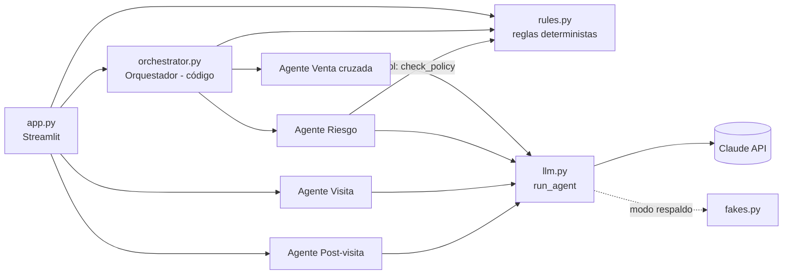
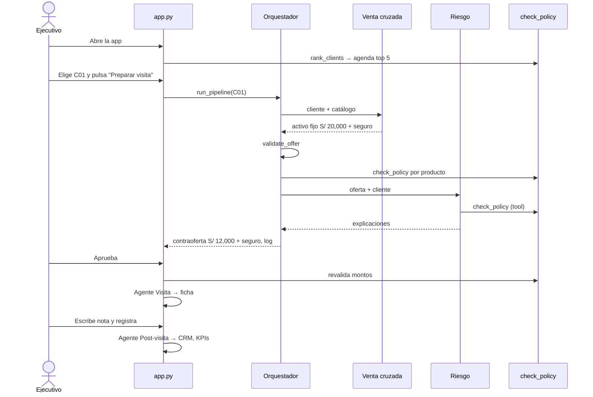

# Crosspilot: diseño

## 1. Principios

1. **El LLM redacta, el código decide.** Montos, riesgo, agenda y flujo son deterministas. Así el demo
   en vivo no depende de que el modelo "se porte bien" y los tests no necesitan la API.
2. **Una app, un proceso.** Streamlit hace de UI y de servidor. Sin backend separado.
3. **Un bucle de agentes.** Los 4 agentes LLM comparten `run_agent()`; cada uno solo cambia su prompt
   y sus herramientas.
4. **Estado por sesión.** Un diccionario `state` en `st.session_state`, pasado como argumento.

## 2. Stack

| Pieza | Elección | Por qué |
|---|---|---|
| UI y hosting | Streamlit + Streamlit Community Cloud | URL pública en minutos, sin frontend aparte. |
| LLM | SDK `anthropic`, tool use | Salidas estructuradas y herramientas sin framework. |
| Modelo | `claude-sonnet-5-5` (variable `CROSSPILOT_MODEL`) | Buen balance velocidad/calidad para demo. Verificar el ID en la doc de modelos. |
| Datos | `data/seed.json` cargado en memoria | 10 clientes no necesitan base de datos. |
| Tests | `pytest` | Corren con el modo respaldo, sin red. |

`requirements.txt`:

```
streamlit
anthropic
pytest
```

## 3. Estructura del repo

```
crosspilot/
├── CLAUDE.md
├── README.md                 # cómo correr y URL del demo (tarea T3.3)
├── requirements.txt
├── app.py                    # UI Streamlit
├── data/
│   └── seed.json             # cartera, catálogo y política (sintéticos)
├── crosspilot/
│   ├── __init__.py
│   ├── data.py               # new_state(), productos por cliente
│   ├── rules.py              # check_policy, rank_clients, validate_offer, validate_crm_entry
│   ├── llm.py                # run_agent(): bucle de tool use + modo respaldo
│   ├── agents.py             # 4 agentes: prompts, herramientas, llamadas
│   ├── fakes.py              # respuestas de respaldo
│   └── orchestrator.py       # pipeline de negociación
├── tests/
│   ├── test_rules.py
│   └── test_flow.py
└── specs/
```

## 4. Arquitectura



Secuencia del demo con el cliente C01:



## 5. Datos

### 5.1 `data/seed.json`

```json
{
  "policy": { "debt_multiple": 6, "max_days_late": 15, "round_to": 500 },
  "catalog": { "<product_id>": { "name": "...", "type": "credito|seguro|ahorro|pagos",
               "min_amount": 0, "max_amount": 0, "annual_margin": 0 } },
  "clients": { "<client_id>": { "name": "...", "business": "...", "district": "...",
               "monthly_net_income": 0, "current_debt": 0, "max_days_late_12m": 0,
               "products": ["<product_id>"], "signals": ["..."] } }
}
```

- `current_debt`: deuda total del cliente en el sistema financiero.
- `min_amount` y `max_amount` solo aplican a créditos; en los demás productos van en `null`.
- `annual_margin`: margen anual ilustrativo por producto, usado solo para ordenar la agenda.

### 5.2 Política

| Campo | Valor | Regla |
|---|---|---|
| `debt_multiple` | 6 | Deuda total después del crédito ≤ 6 × ingreso neto mensual. |
| `max_days_late` | 15 | Con más de 15 días de atraso máximo en 12 meses, no se ofrece crédito. |
| `round_to` | 500 | Los montos máximos se redondean hacia abajo a múltiplos de S/ 500. |

### 5.3 Catálogo

| product_id | Nombre | Tipo | Mín. S/ | Máx. S/ | Margen anual S/ (ilustrativo) |
|---|---|---|---|---|---|
| `credito_capital_trabajo` | Crédito capital de trabajo | credito | 1,000 | 50,000 | 600 |
| `credito_activo_fijo` | Crédito activo fijo | credito | 5,000 | 80,000 | 800 |
| `seguro_negocio` | Seguro de negocio | seguro | – | – | 150 |
| `cuenta_ahorro` | Cuenta de ahorro | ahorro | – | – | 60 |
| `cobro_qr` | Cobro con QR | pagos | – | – | 120 |

### 5.4 Cartera (10 clientes sintéticos)

| id | Nombre | Negocio | Distrito | Ingreso neto | Deuda | Atraso 12m | Productos |
|---|---|---|---|---|---|---|---|
| C01 | Rosa Huamán | Taller de confección | La Victoria | 3,000 | 6,000 | 3 | capital_trabajo, cuenta_ahorro |
| C02 | Jorge Mamani | Bodega | San Juan de Lurigancho | 1,500 | 0 | 0 | cuenta_ahorro, cobro_qr |
| C03 | Lucía Torres | Restaurante | Surquillo | 4,000 | 10,000 | 25 | capital_trabajo |
| C04 | Pedro Salazar | Ferretería | Los Olivos | 6,000 | 30,000 | 0 | activo_fijo, cuenta_ahorro, seguro_negocio |
| C05 | Ana Flores | Salón de belleza | Miraflores | 2,500 | 14,000 | 5 | cuenta_ahorro |
| C06 | Luis Rojas | Taller mecánico | Comas | 2,000 | 12,000 | 10 | activo_fijo |
| C07 | Carmen Díaz | Abarrotes al por mayor | La Victoria | 5,000 | 5,000 | 0 | capital_trabajo, cuenta_ahorro, cobro_qr, seguro_negocio |
| C08 | Miguel Paredes | Carpintería | Villa El Salvador | 2,800 | 3,000 | 18 | cuenta_ahorro, capital_trabajo |
| C09 | Sofía Ramos | Tienda de ropa | La Victoria | 3,500 | 20,000 | 2 | capital_trabajo, seguro_negocio, cobro_qr |
| C10 | Raúl Chávez | Imprenta | Breña | 4,500 | 8,000 | 0 | activo_fijo, capital_trabajo, cuenta_ahorro |

En `seed.json` los productos usan el `product_id` completo (`credito_capital_trabajo`, no `capital_trabajo`).
Total inicial: 22 productos en 10 clientes, es decir **2.2 productos por cliente**.

Señales (`signals`), 2 o 3 por cliente. Las de C01 son fijas porque guían el demo:

- **C01:** "Cotizó una remalladora industrial de S/ 20,000", "Cobra a clientes mayoristas por
  transferencia y QR de otros bancos", "Su maquinaria no tiene seguro".
- **Resto:** escribirlas coherentes con el negocio y los productos (por ejemplo, C02: "Sus ventas suben
  en diciembre", "Paga a proveedores en efectivo"; C03: "Atrasos recientes por una obra frente al local").

Puntajes esperados de `rank_clients` (los verifica un test):

| Pos. | Cliente | Puntaje | Elegibles |
|---|---|---|---|
| 1 | C01 | 1,070 | activo_fijo, seguro_negocio, cobro_qr |
| 2 | C02 | 950 | capital_trabajo, activo_fijo, seguro_negocio (cuenta solo el mejor crédito) |
| 3 | C05 | 870 | capital_trabajo, seguro_negocio, cobro_qr |
| 4 | C07 | 800 | activo_fijo |
| 5 | C04 | 720 | capital_trabajo, cobro_qr |

### 5.5 Estado de sesión

```python
state = {
    "policy": {...}, "catalog": {...}, "clients": {...},   # copia profunda del seed
    "crm": [],                                             # registros de visita
    "stats": {"approved_offers": 0, "accepted_products": 0, "vetoes": 0},
}
```

`data.new_state()` devuelve una copia profunda del seed. `data.products_per_client(state)` devuelve el
promedio redondeado a 1 decimal.

## 6. Reglas deterministas (`rules.py`)

### 6.1 `check_policy(state, client_id, product_id, amount=None) -> dict`

Devuelve `{"approved": bool, "max_amount": int | None, "reasons": [str]}`.

```python
client, product = state["clients"].get(client_id), state["catalog"].get(product_id)
if not client or not product:            -> False, 0, ["cliente o producto inexistente"]
if product_id in client["products"]:     -> False, 0, ["el cliente ya tiene este producto"]
if product["type"] != "credito":         -> True, None, []
if client["max_days_late_12m"] > policy["max_days_late"]:
                                         -> False, 0, ["atraso de N días en 12 meses (máximo 15)"]
headroom   = policy["debt_multiple"] * client["monthly_net_income"] - client["current_debt"]
max_amount = int(min(headroom, product["max_amount"]) // round_to * round_to)
if max_amount < product["min_amount"]:   -> False, 0, ["sin capacidad de endeudamiento suficiente"]
if amount is None:                       -> False, max_amount, ["falta el monto"]
if amount < product["min_amount"]:       -> False, max_amount, ["monto menor al mínimo del producto"]
if amount > max_amount:                  -> False, max_amount, ["excede el límite de endeudamiento: máximo S/ X"]
                                         -> True, max_amount, []
```

Decisión derivada (la usa el Orquestador):

- `approved` es verdadero: **APROBADO**.
- `approved` es falso, el producto es crédito y `max_amount >= min_amount`: **CONTRAOFERTA** por `max_amount`.
- Cualquier otro caso: **VETO**.

Caso C01: capacidad = 6 × 3,000 − 6,000 = 12,000. Activo fijo por 20,000 da **CONTRAOFERTA de 12,000**.

### 6.2 `rank_clients(state, n=5) -> list[dict]`

Para cada cliente:

- `eligible` = productos del catálogo que no tiene, para los cuales `check_policy(..., amount=None)`
  no es VETO. Un crédito con `max_amount >= min_amount` cuenta como elegible.
- `score` = margen del **mejor** crédito elegible (máximo uno) + suma de márgenes de los no créditos elegibles.

Ordena por `score` descendente y, en empate, por `client_id`. Devuelve
`[{"client_id", "score", "eligible": [product_id]}]`.

### 6.3 `validate_offer(state, client_id, items) -> (kept, dropped)`

Recorre `items` en orden. Descarta, con motivo, todo producto que:

1. no exista en el catálogo;
2. el cliente ya tenga;
3. esté repetido;
4. sea crédito sin `amount` entero > 0;
5. sea el segundo crédito de la oferta (la capacidad es una sola);
6. supere el límite de 2 productos.

`dropped` es `[{"product_id", "reason"}]`.

### 6.4 `validate_crm_entry(entry, offered_ids, today) -> list[str]`

Devuelve una lista de errores, vacía si todo está bien: `resultado` dentro de
`{ACEPTO, RECHAZO, LO_PENSARA}`, `productos_aceptados` ⊆ `offered_ids`, `fecha_seguimiento` en formato
`AAAA-MM-DD` y no anterior a `today`, y `resultado == "RECHAZO"` implica `productos_aceptados` vacío.

## 7. Agentes LLM

### 7.1 Bucle común (`llm.py`)

```python
def run_agent(agent, system, user, tools, submit_tool, handlers=None, fake=False, fake_ctx=None):
    if fake:
        return fakes.respond(agent, fake_ctx)
    messages = [{"role": "user", "content": user}]
    for _ in range(5):
        resp = client.messages.create(
            model=MODEL, max_tokens=1500, system=system, tools=tools,
            tool_choice={"type": "any"}, messages=messages)
        messages.append({"role": "assistant", "content": resp.content})
        results = []
        for block in resp.content:
            if block.type != "tool_use":
                continue
            if block.name == submit_tool:
                return block.input
            out = handlers[block.name](**block.input)
            results.append({"type": "tool_result", "tool_use_id": block.id,
                            "content": json.dumps(out, ensure_ascii=False)})
        messages.append({"role": "user", "content": results})
    raise AgentError(agent)
```

- `tool_choice={"type": "any"}` obliga a responder siempre con una herramienta: o una de datos o la de envío.
- El cliente se crea con `anthropic.Anthropic(timeout=60)`; la API key se lee del entorno.
- Errores de la API (`anthropic.APIError`) y de agotar los 5 turnos se convierten en `AgentError(agent)`.
- `MODEL = os.environ.get("CROSSPILOT_MODEL", "claude-sonnet-5-5")`.

El mensaje `user` de cada agente es JSON (`ensure_ascii=False`) con los datos que necesita.

### 7.2 Agente Venta cruzada

- **Entrada:** el cliente (sin los datos de deuda ni atraso: no es su trabajo) + catálogo + productos que ya tiene.
- **Herramientas:** solo `submit_offer`.

```json
{
  "name": "submit_offer",
  "description": "Envía la propuesta de venta cruzada.",
  "input_schema": {
    "type": "object",
    "properties": {
      "items": {
        "type": "array", "minItems": 1, "maxItems": 2,
        "items": {
          "type": "object",
          "properties": {
            "product_id": {"type": "string", "enum": ["<ids del catálogo>"]},
            "amount": {"type": ["integer", "null"], "description": "Soles. Solo créditos."},
            "reason": {"type": "string", "description": "Señal del cliente que lo justifica."}
          },
          "required": ["product_id", "amount", "reason"]
        }
      },
      "pitch": {"type": "string", "description": "Una frase para el ejecutivo."}
    },
    "required": ["items", "pitch"]
  }
}
```

**System prompt:**

> Eres el agente Venta cruzada de Crosspilot, el copiloto de un ejecutivo de negocios de un banco de
> microfinanzas en Perú. Tu trabajo es proponer el siguiente producto para un cliente que ya es del banco.
> Reglas: propón 1 o 2 productos del catálogo que el cliente no tenga; como máximo uno de crédito. Para
> créditos indica el monto en soles que el negocio necesita según sus señales; para los demás, amount
> es null. Justifica cada producto con una señal concreta del cliente. No evalúes riesgo: otro agente lo
> hace. Responde siempre llamando a submit_offer, en español y con frases cortas.

### 7.3 Agente Riesgo

- **Entrada:** el cliente completo + la oferta ya validada.
- **Herramientas:** `check_policy` (handler: `rules.check_policy` con `state` fijado) y `submit_risk_review`.

```json
{
  "name": "check_policy",
  "description": "Evalúa un producto contra la política de riesgo. Su resultado es definitivo.",
  "input_schema": {
    "type": "object",
    "properties": {
      "client_id": {"type": "string"},
      "product_id": {"type": "string"},
      "amount": {"type": ["integer", "null"]}
    },
    "required": ["client_id", "product_id", "amount"]
  }
}
```

```json
{
  "name": "submit_risk_review",
  "description": "Envía la explicación de riesgo por producto.",
  "input_schema": {
    "type": "object",
    "properties": {
      "explanations": {
        "type": "array",
        "items": {
          "type": "object",
          "properties": {
            "product_id": {"type": "string"},
            "explanation": {"type": "string", "description": "Máximo 25 palabras."}
          },
          "required": ["product_id", "explanation"]
        }
      }
    },
    "required": ["explanations"]
  }
}
```

**System prompt:**

> Eres el agente Riesgo de Crosspilot. Revisa la oferta para el cliente. Para cada producto llama a
> check_policy con su monto. El resultado de check_policy es definitivo: no puedes cambiarlo. Luego
> llama a submit_risk_review con una explicación de máximo 25 palabras por producto, clara para el
> ejecutivo. Si hay un monto máximo menor al propuesto, menciónalo y di qué regla lo limita. Cuida que
> la venta sea sana para el cliente.

La decisión y el monto los calcula el Orquestador llamando a `check_policy` él mismo (§8). Si el agente
omite una llamada o una explicación, el Orquestador usa `reasons` de la regla como explicación.

### 7.4 Agente Visita

- **Entrada:** el cliente + los ítems aprobados (producto, monto) + el `pitch`.
- **Herramientas:** solo `submit_brief`.

```json
{
  "name": "submit_brief",
  "input_schema": {
    "type": "object",
    "properties": {
      "resumen": {"type": "string"},
      "oferta": {"type": "array", "items": {"type": "string"}},
      "talking_points": {"type": "array", "minItems": 3, "maxItems": 3, "items": {"type": "string"}},
      "objeciones": {
        "type": "array", "minItems": 2, "maxItems": 2,
        "items": {"type": "object",
                  "properties": {"objecion": {"type": "string"}, "respuesta": {"type": "string"}},
                  "required": ["objecion", "respuesta"]}
      },
      "siguiente_paso": {"type": "string"}
    },
    "required": ["resumen", "oferta", "talking_points", "objeciones", "siguiente_paso"]
  }
}
```

**System prompt:**

> Eres el agente Visita de Crosspilot. Con el cliente y la oferta aprobada, escribe una ficha que el
> ejecutivo lea en un minuto antes de la visita: resumen del cliente en dos líneas, la oferta tal cual
> está aprobada, 3 puntos de conversación basados en las señales del cliente, 2 objeciones probables con
> su respuesta y el siguiente paso. No cambies productos ni montos. Llama a submit_brief.

La sección "oferta" de la UI se arma desde los ítems aprobados, no desde el texto del agente (R6.2).

### 7.5 Agente Post-visita

- **Entrada:** la nota del ejecutivo + los ítems aprobados + la fecha de hoy.
- **Herramientas:** solo `submit_crm_entry`.

```json
{
  "name": "submit_crm_entry",
  "input_schema": {
    "type": "object",
    "properties": {
      "resultado": {"type": "string", "enum": ["ACEPTO", "RECHAZO", "LO_PENSARA"]},
      "productos_aceptados": {"type": "array", "items": {"type": "string"}},
      "siguiente_accion": {"type": "string"},
      "fecha_seguimiento": {"type": "string", "description": "AAAA-MM-DD"},
      "resumen": {"type": "string"}
    },
    "required": ["resultado", "productos_aceptados", "siguiente_accion", "fecha_seguimiento", "resumen"]
  }
}
```

**System prompt** (con `{today}` y `{offered_ids}` reemplazados):

> Eres el agente Post-visita de Crosspilot. Convierte la nota del ejecutivo en un registro de CRM. Hoy
> es {today}. Los productos aceptados solo pueden ser estos: {offered_ids}. Si la nota no indica fecha
> de seguimiento, usa hoy más 7 días. Llama a submit_crm_entry.

La salida pasa por `validate_crm_entry`. Si hay errores, se muestran y no se guarda nada.

## 8. Orquestador (`orchestrator.py`)

`run_pipeline(state, client_id, fake=False) -> dict`. Es código, no LLM.

1. Log ORQUESTADOR: "Preparo la visita a {nombre}: buscamos el siguiente producto."
2. `offer = agents.cross_sell(...)`.
3. `kept, dropped = rules.validate_offer(...)`. Log VENTA CRUZADA con `pitch` y cada ítem (producto,
   monto, razón). Si hay `dropped`, log ORQUESTADOR: "Descarté {producto}: {motivo}". Si `kept` está
   vacío: estado `SIN_OFERTA`, fin.
4. Para cada ítem: `check_policy` y su decisión derivada (§6.1). Sumar 1 a `stats.vetoes` por cada VETO.
5. `review = agents.risk(...)`. Log RIESGO: un mensaje con decisión y explicación por producto.
6. Ítems finales: APROBADO se queda igual, CONTRAOFERTA cambia su monto a `max_amount`, VETO sale.
7. Log ORQUESTADOR de cierre:
   - con contraoferta: "Acepto la contraoferta de Riesgo: {producto} por S/ {monto}. Pasa a aprobación del ejecutivo.";
   - todo aprobado: "Riesgo aprobó la oferta completa. Pasa a aprobación del ejecutivo.";
   - todo vetado: "No hay oferta viable para este cliente hoy." y estado `SIN_OFERTA`.

Retorno:

```python
{"client_id": "C01", "status": "PENDIENTE_APROBACION" | "SIN_OFERTA", "pitch": str,
 "items": [{"product_id", "amount", "reason", "decision", "explanation"}],   # solo finales
 "log": [{"sender": "ORQUESTADOR" | "VENTA CRUZADA" | "RIESGO", "text": str}]}
```

Los montos en los mensajes van con formato `S/ 12,000`.

## 9. Aprobación humana

Estados de la visita, guardados en `st.session_state["visit"]`:

```
PENDIENTE_APROBACION --Aprobar (revalidación ok)--> APROBADA --Registrar--> CERRADA
PENDIENTE_APROBACION --Rechazar--> RECHAZADA
SIN_OFERTA (fin)
```

- En `PENDIENTE_APROBACION` cada ítem muestra una casilla "Incluir" y, si es crédito, un
  `number_input` con paso de 500 y valor inicial igual al monto final.
- Al aprobar: se exige al menos un ítem incluido, se revalida cada crédito con `check_policy` y,
  si alguno falla, se muestra `st.error` con los motivos y no se cambia el estado.
- Aprobación válida: `stats.approved_offers += 1`, se llama al agente Visita y se guarda la ficha.
- Al registrar con productos aceptados: se agregan a `client["products"]` y se suman a
  `stats.accepted_products`.

## 10. Interfaz (`app.py`)

`st.set_page_config(page_title="Crosspilot", layout="wide")`. Una sola página, de arriba abajo:

**Barra lateral**
- Título "Crosspilot" y subtítulo "Copiloto de venta cruzada".
- `st.toggle("Modo respaldo")`, encendido por defecto si `CROSSPILOT_FAKE_LLM=1`.
- 4 `st.metric`: Productos por cliente (con delta frente a 2.2), Ofertas aprobadas, Productos aceptados, Vetos de riesgo.
- Botón "Reiniciar demo" (R10).

**1. Agenda del día**
- `st.dataframe` con el top 5 de `rank_clients`: cliente, negocio, productos actuales, elegibles y puntaje.
- `st.selectbox` con toda la cartera; por defecto, el primero de la agenda.
- Botón "Preparar visita": ejecuta `run_pipeline` dentro de `st.spinner("Los agentes están trabajando…")`.

**2. Negociación entre agentes**
- Un `st.chat_message(sender, avatar=...)` por cada entrada del log. Avatares: 🎯 VENTA CRUZADA,
  🛡️ RIESGO, 🧭 ORQUESTADOR.

**3. Aprobación del ejecutivo** (solo en `PENDIENTE_APROBACION`)
- Ítems editables (§9) y botones "Aprobar" y "Rechazar".

**4. Ficha de visita** (desde `APROBADA`)
- Resumen, oferta (desde los ítems aprobados), puntos de conversación, objeciones y siguiente paso.

**5. Post-visita** (desde `APROBADA`)
- `st.text_area("Nota de la visita")` y botón "Registrar".
- `st.dataframe` del CRM de la sesión.

Toda llamada a un agente se envuelve así: `try` → si hay `AgentError`, `st.error("El agente {X} no
respondió. Activa el Modo respaldo y vuelve a intentar.")`. El estado no se toca si falla.

## 11. Modo respaldo (`fakes.py`)

`respond(agent, ctx) -> dict`, con la misma forma que la herramienta `submit_*` de cada agente.

- **C01 (fijo, es el guion del demo):**
  - cross_sell: `credito_activo_fijo` por 20,000 ("Cotizó una remalladora de S/ 20,000") + `seguro_negocio`
    ("Su maquinaria no tiene seguro"). Pitch: "Financiar la remalladora y proteger el taller."
  - risk: explicaciones coherentes con la contraoferta de 12,000.
  - brief: ficha completa redactada para el taller de confección.
  - post_visit: ACEPTO ambos productos, seguimiento hoy + 7 días.
- **Otros clientes (genérico):**
  - cross_sell: el primer crédito elegible de `rank_clients` por su máximo + 1,000, más el primer no
    crédito elegible. El +1,000 fuerza una contraoferta visible. Sin crédito elegible: los dos primeros
    no créditos elegibles. Sin elegibles: un solo ítem con el primer producto del catálogo, para que
    `validate_offer` lo descarte y se vea "Sin oferta viable".
  - risk, brief y post_visit: textos genéricos armados con los datos del contexto.

`ctx` incluye `state`, `client_id`, la oferta o ítems según el agente, y `today`.

## 12. Configuración

| Variable | Default | Uso |
|---|---|---|
| `ANTHROPIC_API_KEY` | – | La lee el SDK. En Streamlit Cloud va en Secrets. |
| `CROSSPILOT_MODEL` | `claude-sonnet-5-5` | ID del modelo. |
| `CROSSPILOT_FAKE_LLM` | `0` | `1` enciende el modo respaldo por defecto. |

## 13. Tests

Todos usan `new_state()` y `fake=True`. Ninguno necesita red.

`tests/test_rules.py`
- C01 con activo fijo por 20,000: `approved=False`, `max_amount=12000` (CONTRAOFERTA).
- C03 con cualquier crédito: VETO por atraso.
- Producto no crédito que el cliente no tiene: aprobado.
- Producto que el cliente ya tiene: rechazado.
- `rank_clients` top 5 = `["C01", "C02", "C05", "C07", "C04"]` con puntajes `[1070, 950, 870, 800, 720]`.
- `validate_offer` descarta un producto ya contratado, uno inexistente, un segundo crédito y un crédito sin monto.
- `validate_crm_entry` rechaza un producto fuera de la oferta y una fecha pasada.

`tests/test_flow.py`
- `run_pipeline(C01, fake=True)`: estado `PENDIENTE_APROBACION`, ítems finales activo fijo 12,000 +
  seguro, y el log empieza y termina con ORQUESTADOR e incluye VENTA CRUZADA y RIESGO.
- Flujo completo C01 en fake: aprobar, registrar ACEPTO, y productos por cliente pasa de 2.2 a 2.4.

## 14. Despliegue

1. Repo público en GitHub con `app.py` en la raíz.
2. Streamlit Community Cloud: nueva app desde el repo, archivo principal `app.py`.
3. En Secrets: `ANTHROPIC_API_KEY = "..."`. Verificar en la doc de Streamlit cómo se exponen los
   Secrets; si no llegan como variable de entorno, pasar `st.secrets["ANTHROPIC_API_KEY"]` al crear el cliente.
4. Probar la URL con el modo respaldo encendido y apagado.

## 15. Seguridad y datos

- Solo datos sintéticos. Los nombres de la cartera son inventados.
- La API key nunca se imprime ni se guarda en `session_state`.
- Toda entrada del ejecutivo (montos, nota) y toda salida del LLM se valida en `rules.py` antes de cambiar el estado.
- `.gitignore` incluye `.env`, `.streamlit/secrets.toml` y `__pycache__/`.
